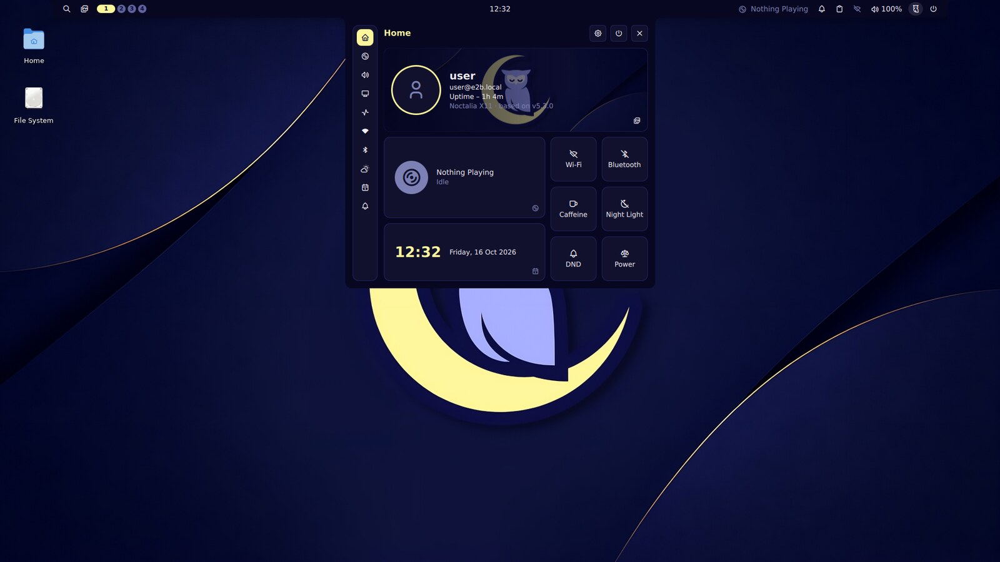
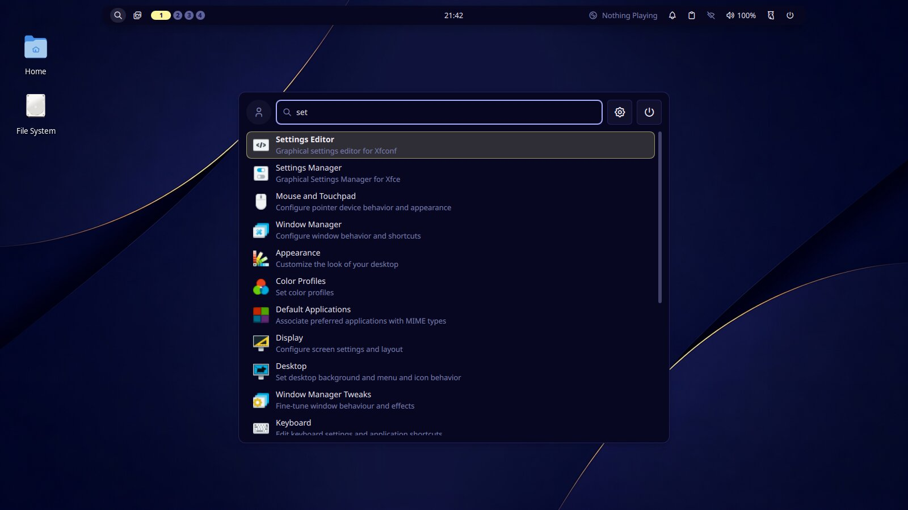
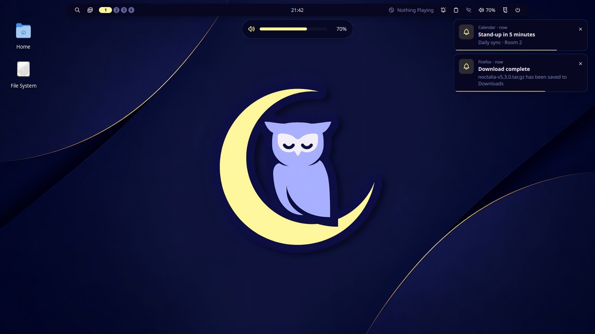
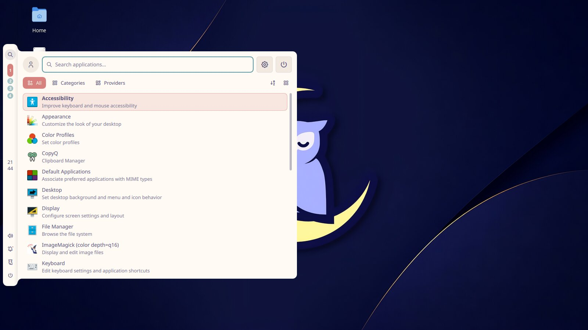
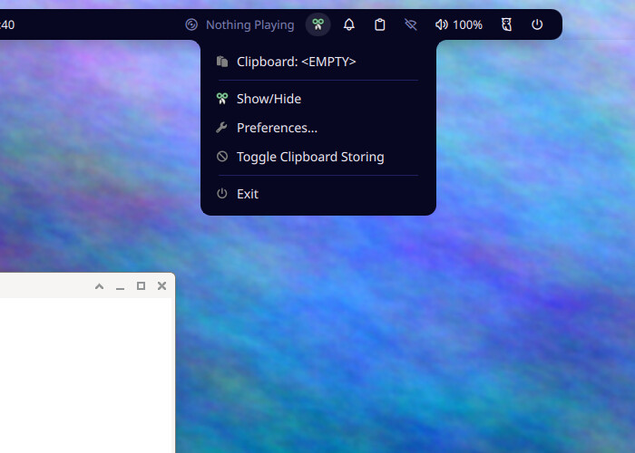

## NOTE
```
This is a port generated by an Agentic A.I. (used on [arena.ai](https://arena.ai)). The "chat" can be viewed on `/Agent_AI/arena.ai-agentic_chat.md`.  
I run a check with ChatGPT and its "report" can be viewed on `/Agent_AI/chatgpt-noctalia_x11_detailed_audit.md`.  
I also included the archives presented by the Agentic AI and can be accessed on the `/Agent_AI/` folder.  
I gave a quick test of both versions by running `qs -p ~/.config/quickshell/noctalia-x11/shell.qml`  and for what I could see, it worked.  
But if you try to actually run it, you are on your own. I am not responsible for what happens.  
I uploaded it for this repo just for future references.  
```

# Noctalia X11

A [Quickshell](https://quickshell.org) port of **[noctalia](https://github.com/noctalia-dev/noctalia) v5.3.0**
for **X11** window managers, made for **XFCE / xfwm4**.



noctalia v5 is a native C++/Wayland shell. It talks to Wayland compositors (Niri, Hyprland,
Sway, labwc…) through layer-shell, ext-workspace, foreign-toplevel and session-lock protocols,
so it cannot run on X11. This project re-implements its design, defaults, config schema and IPC
vocabulary as a Quickshell (QML) configuration, and replaces every Wayland-only piece with an
X11 equivalent:

| noctalia v5 (Wayland) | Noctalia X11 |
|---|---|
| layer-shell bars and panels | Quickshell `PanelWindow` → X11 dock windows with `_NET_WM_STRUT_PARTIAL` |
| ext-workspace / compositor IPC | EWMH desktops (`_NET_CURRENT_DESKTOP`, …) through `scripts/x11-bridge.py` |
| foreign-toplevel (taskbar, active window, `/win`) | `_NET_CLIENT_LIST`, `_NET_ACTIVE_WINDOW`, `WM_CLASS` from the bridge |
| compositor keyboard-layout IPC, lock keys | XKB group and indicator state from the bridge |
| ext-idle-notify | XScreenSaver idle time from the bridge |
| ext-session-lock lock screen | your XFCE screen locker (`xflock4`; configurable) |
| wlr-gamma night light | redshift / gammastep / sct / `xrandr --gamma` |
| wallpaper surface + transitions | xfdesktop through xfconf (desktop icons keep working), or feh / xwallpaper / hsetroot |
| idle inhibitor | xfce4-power-manager presentation mode + `systemd-inhibit` + `xset` |

The bridge is a small dependency-free Python 3 script (ctypes against libX11). It streams
JSON events and accepts commands, so the shell reacts instantly to workspace and window changes
instead of polling `wmctrl`.

## Features

<table>
<tr><td></td><td></td></tr>
<tr><td></td><td></td></tr>
</table>

- **Look**
  - The 10 built-in noctalia palettes, generated from the v5.3.0 sources: Ayu, Catppuccin, Dracula, Eldritch, Gruvbox, Kanagawa, Noctalia, Nord, Rosé Pine and Tokyo-Night.
  - Dark, light and auto (sunset/sunrise) modes, plus wallpaper-derived palettes (`[theme] source = "wallpaper"`).
  - noctalia's style tokens (radii, spacing, typography, control sizes).
  - The bundled noctalia Tabler icon font and its glyph aliases.
  - noctalia's own translation catalogs (27 languages).
- **Bar**
  - Several bars, on any edge (`[bar.<name>]`, ordered by `[bar] order`), with per-monitor overrides (`[bar.<name>.monitor.<selector>]`).
  - Floating (`margin_edge > 0`) or docked, with noctalia's concave edge corners, capsule styles, hover highlight, tooltips, auto-hide and smart auto-hide.
  - noctalia's gesture model: per-type defaults, `[bar.<name>.actions]`, `[widget.<name>.actions]` and the bar dead zone (`[bar.<name>.dead_zone.actions]`).
  - noctalia's built-in widget instances (`cpu`, `temp`, `ram`, `network_tx`, `network_rx`, `output_volume`, `input_volume`, `date`, …).
  - Widgets: `launcher`, `control-center`, `workspaces` (regular, minimal and focus_hint styles), `taskbar`, `active_window`, `clock`, `media`, `tray`, `notifications`, `clipboard`, `network`, `bluetooth`, `volume`, `brightness`, `battery`, `sysmon`, `keyboard_layout`, `lock_keys`, `caffeine`, `nightlight`, `power_profile`, `theme_mode`, `weather`, `wallpaper`, `screenshot`, `session`, `settings`, `spacer`, `text` and `custom_button`.
- **Panels**
  - Attached panels grow out of the bar with noctalia's concave corners. Floating panels are centred.
  - All panels close on Esc or an outside click, and take keyboard focus through EWMH.
- **Control Center**
  - Tabs: Home (user card, media, clock and weather, six shortcut tiles), Media, Audio (devices, inputs, per-app volume), Monitor (backlight and DDC/CI brightness, night light), System (live graphs), Network (Wi-Fi via NetworkManager), Bluetooth (BlueZ), Weather (open-meteo), Calendar, Notifications and Power.
- **Launcher**
  - The "full" layout (Recent, Pinned, All, Categories, Providers), or the "simple" layout.
  - Fuzzy search with usage boosting, pinning (right-click), and list or grid view.
  - Providers: calculator (global), `/emo`, `/win`, `/session`, `/wall` and `/pan`.
- **Other surfaces**
  - Session menu: lock, log out, lock & suspend, reboot, shut down and custom entries, with number-key shortcuts and optional countdowns.
  - Notifications daemon: toasts, actions, history, Do Not Disturb and noctalia's filters (`[notification.filter.*]`, `filter_order`, `blacklist`).
  - OSD cards for volume, brightness, toggles, power profiles, media tracks, keyboard layout and lock keys (horizontal or vertical).
  - Low-battery warnings (`[battery] warning_threshold`) and the idle pre-action fade.
  - Clipboard history with pinning and auto-paste.
  - Wallpaper picker with per-monitor support, random/next and automation.
  - Dock: pinned and running apps, magnification, auto-hide.
- **Plumbing**
  - noctalia's config stack: every `*.toml` in the config directory, `[include]`, the `settings.toml` overlay and hot reload.
  - `[hooks]` for shell events, with noctalia's event names and environment variables.
  - The noctalia IPC command set through `noctalia-msg`.

## Requirements

- **Quickshell ≥ 0.2.0**, built with X11 support (on by default), and **Qt ≥ 6.7** including the QtQuick Shapes QML module (`qml6-module-qtquick-shapes` on Debian/Ubuntu). Tested with Quickshell 0.3.2 and Qt 6.8.2 under xfwm4 4.20.
- **python3** (for the X11 bridge; standard library only) and libX11. libXss is optional and provides idle detection.
- **An X11 compositor for transparency and rounded corners.** xfwm4's built-in compositor is on by default.
- **Optional:**

  | Tool | Used for |
  |---|---|
  | NetworkManager (`nmcli`) | network widget and Wi-Fi panel |
  | PipeWire | volume widgets and the Audio tab |
  | BlueZ | Bluetooth |
  | UPower and power-profiles-daemon | battery and power profiles |
  | `brightnessctl` | backlight |
  | `ddcutil` | external monitor brightness over DDC/CI (`[brightness] enable_ddcutil = true`) |
  | `xfconf-query` | XFCE integration |
  | `xdotool` | auto-paste |
  | redshift, gammastep, sct or xrandr | night light |
  | xfce4-screenshooter, flameshot, maim or scrot | screenshots |
  | `snixembed` (or `xembedsniproxy`) | showing old XEmbed-only tray icons |

Distro package hints:

```sh
# Debian/Ubuntu (Quickshell itself: build from source, see below)
sudo apt install python3 qml6-module-qtquick-shapes network-manager pipewire wireplumber upower \
                 power-profiles-daemon brightnessctl xdotool redshift xfce4-screenshooter fonts-noto-color-emoji
# Arch
sudo pacman -S quickshell python networkmanager pipewire wireplumber upower power-profiles-daemon \
               brightnessctl xdotool redshift
# Fedora
sudo dnf copr enable errornointernet/quickshell && sudo dnf install quickshell
```

### Installing Quickshell

Prebuilt packages:

- Arch: `quickshell` from the official repos or the AUR.
- Fedora: COPR `errornointernet/quickshell`.
- NixOS: the flake.

Building from source on Debian 13 or Ubuntu 25.04+:

```sh
sudo apt install cmake ninja-build pkg-config qt6-base-dev qt6-base-private-dev \
  qt6-declarative-dev qt6-declarative-private-dev qt6-shadertools-dev qt6-svg-dev spirv-tools \
  libcli11-dev libdrm-dev libxcb1-dev libpipewire-0.3-dev libpam0g-dev libpolkit-agent-1-dev \
  libglib2.0-dev libjemalloc-dev qml6-module-qtquick-shapes qml6-module-qtquick-effects
git clone https://git.outfoxxed.me/quickshell/quickshell && cd quickshell
cmake -GNinja -B build -DCMAKE_BUILD_TYPE=Release -DWAYLAND=OFF -DCRASH_HANDLER=OFF
cmake --build build && sudo cmake --install build
```

## Installation

```sh
tar -xzf noctalia-x11.tar.gz && cd noctalia-x11
./install.sh                 # copies into ~/.config/quickshell/noctalia-x11, installs noctalia-msg,
                             # creates a starter config (if you have none) and an autostart entry
qs -c noctalia-x11           # start it
```

If the files lost their executable bit (for example after copying them through a tool that does not
keep permissions), run `bash install.sh` instead. Use `./install.sh --link` to symlink instead of
copying, and `./install.sh --uninstall` to remove it again. Your config and state are kept. Running
the installer from inside `~/.config/quickshell/noctalia-x11` is safe: it never deletes its own
source tree.

### XFCE integration

`scripts/xfce-setup.sh` makes the common adjustments. Run it with `--all`, or pick individual steps:

| Option | What it does |
|---|---|
| `--compositor` | Turns on xfwm4 compositing. Without it, transparent areas render black. |
| `--notifications` | Stops and masks **xfce4-notifyd**. Only one notification daemon can own `org.freedesktop.Notifications`, so this is required for Noctalia toasts. |
| `--shortcuts` | Binds <kbd>Super</kbd>+<kbd>Space</kbd> launcher, <kbd>Super</kbd>+<kbd>S</kbd> control center, <kbd>Super</kbd>+<kbd>V</kbd> clipboard, <kbd>Super</kbd>+<kbd>Esc</kbd> session menu and <kbd>Super</kbd>+<kbd>,</kbd> wallpaper picker. |
| `--media-keys` | Sends volume and media keys to Noctalia. Use this if you remove xfce4-panel, because its PulseAudio plugin normally handles those keys. |
| `--hide-panel` | Quits **xfce4-panel** for the current session. To make that permanent, open *Settings → Session and Startup → Current Session*, set xfce4-panel's *Restart Style* to *Never*, then *Save Session*. You can also keep xfce4-panel; Noctalia's bars reserve their own space next to it. |
| `--revert` | Undoes the shortcut, media-key and notifyd changes. |

Other notes:

- **Locking:** the *Lock* action runs `xflock4`, which uses whatever locker XFCE is set to (xfce4-screensaver, light-locker, xscreensaver…). Set `[x11] lock_command` to use another one. An X11 client cannot implement a secure lock screen the way ext-session-lock does, so Noctalia deliberately does not draw its own.
- **Wallpaper:** the picker and `wallpaper-*` commands write xfdesktop's `last-image` keys for every workspace.

## Configuration

Configuration follows noctalia v5.3.0's model:

1. **Built-in defaults** – noctalia's own C++ defaults (not the partly outdated `example.toml`).
2. **Every `*.toml` file in the config directory**, merged in alphabetical (bytewise) order: tables merge
   recursively, scalars and arrays are replaced. Split your config however you like (`10-bar.toml`,
   `20-theme.toml`, …).
   - `[include] files = ["themes/dark.toml", "~/shared/noctalia", "$XDG_CONFIG_HOME/x.toml"]` pulls in
     files or whole directories (their `*.toml`, sorted). `~`, `$VAR` and `${VAR}` are expanded, relative
     paths resolve against the including file, a file's own keys win over what it includes, and every
     file loads at most once.
   - `[include] autoload = false` in a root file turns the directory into profiles: only the root
     files that set it (and their includes) are loaded.
3. **`settings.toml`** in the state directory, merged last.

Where the config directory is (first match wins):

| Source | Config directory | `settings.toml` |
|---|---|---|
| `$NOCTALIA_X11_CONFIG` | that directory, or that single `.toml` file (+ its includes) | `~/.local/state/noctalia-x11/` |
| own | `~/.config/noctalia-x11/` (if it contains a `*.toml`) | `~/.local/state/noctalia-x11/` |
| native noctalia, read-only | `${NOCTALIA_CONFIG_HOME:-~/.config}/noctalia/` | `${NOCTALIA_STATE_HOME:-~/.local/state}/noctalia/` |

Every loaded file, include directory and `settings.toml` is watched; saving, adding or removing a file
reloads the shell. Like noctalia, a TOML error or a missing include anywhere keeps the previous
configuration and shows a persistent notification that points at the file and line.

The schema is noctalia's (`[bar.<name>]`, `[widget.<name>]`, `[shell.launcher]`, `[notification]`, …).
Only `[bar.<name>]` tables create bars; without any, one bar named `default` uses noctalia's defaults
(docked at the top, `margin_ends = 100`, concave edge corners). Unknown keys are ignored. See
[`config.example.toml`](config.example.toml) for everything this port reads.

X11-specific settings live in `[x11]`:

| Key | Purpose |
|---|---|
| `lock_command`, `logout_command` | Session commands. Empty means auto-detect. |
| `wallpaper_backend` | `auto`, `xfdesktop`, `feh`, `xwallpaper`, `hsetroot` or `none`. |
| `gtk_theme_dark`, `gtk_theme_light`, `icon_theme_dark`, `icon_theme_light` | Themes to switch through xsettings when the theme mode changes. |
| `terminal` | Terminal for `Terminal=true` apps. |
| `settings_command` | Command for the settings buttons (default: open the config file in an editor). |
| `screenshot_region_command`, `screenshot_full_command` | Override the screenshot tools. |
| `focus_method` | How panels take keyboard focus: `bridge` (EWMH `_NET_ACTIVE_WINDOW`) or `qt` (`QWindow.requestActivate`). |
| `paste_tool` | Tool used for auto-paste (`xdotool`). |

Runtime state lives in `~/.local/state/noctalia-x11/state.json`. It holds DND, caffeine, the theme
mode / palette chosen through IPC (reset when you edit `[theme]`), wallpapers, launcher usage,
clipboard history and notification history.

## IPC

```sh
noctalia-msg panel-toggle launcher            # or: control-center [tab] | session | clipboard | wallpaper
noctalia-msg volume-up 5% | volume-set 0.4 | volume-mute | mic-mute
noctalia-msg brightness-down 10 | brightness-set all 40% | brightness-set DP-1 70
noctalia-msg media toggle | media next
noctalia-msg notification-dnd-toggle | notification-clear-history
noctalia-msg wallpaper-random | wallpaper-set ~/Pictures/wall.jpg
noctalia-msg theme-mode-toggle | color-scheme-set builtin Nord | color-scheme-set wallpaper m3-content
noctalia-msg caffeine-toggle | nightlight-toggle | wifi-toggle | bluetooth-toggle | network-toggle
noctalia-msg bar-hide | bar-toggle top HDMI-1 | bar-auto-hide-set smart | bar-reserve-toggle
noctalia-msg session lock | session reboot
noctalia-msg status                            # JSON
noctalia-msg workspace 2 | workspace-next | keyboard-layout-next   # X11 extras
noctalia-msg --help                            # full list
```

`noctalia-msg` wraps `qs -c noctalia-x11 ipc call noctalia msg "<command>"`. Replies follow noctalia:
`ok`, a value, or `error: …`. Levels accept noctalia's syntax (`65`, `65%` or `0.65`). Monitor
selectors are a connector name (`DP-1`) or a word of the monitor's make/model/serial. The same commands
work in `[widget.<name>.actions]`, `[bar.<name>.dead_zone.actions]` and the Control Center
shortcuts. `exec <cmd>` runs a shell command.

## Layout of this repository

```
shell.qml              entry point (bars, panel hosts, toasts, OSD, dock per screen; IPC)
Commons/               Config (config stack, TOML parser, merge rules, defaults, gesture defaults),
                       Theme (palettes), Style, Icons, I18n, State, utils
Services/              X11 (bridge), Audio, Network, Bluetooth, Power, Media, Notifications, Session,
                       Idle, NightLight, Wallpaper, Clipboard, Weather, SystemMonitor, Panels, Commands …
Widgets/               N* controls (buttons, toggles, sliders, cards, text fields, graphs, tooltips)
Modules/Bar/           bar window, widget loader, all bar widgets
Modules/Panels/        per-screen panel host + attached/floating panel frame
Modules/ControlCenter/ Control Center and its tabs
Modules/{Launcher,Session,WallpaperPicker,ClipboardPanel,TrayMenu,Notifications,Osd,Dock,Ipc}/
scripts/x11-bridge.py  EWMH / XKB / XScreenSaver bridge (python3 + ctypes)
scripts/xfce-setup.sh  XFCE integration helper
assets/                noctalia's Tabler icon font + glyph map, translations, emoji data, wallpaper, logo
```

## Not ported (yet)

These parts of noctalia v5.3.0 are not reproduced:

- The settings GUI and setup wizard. The settings buttons open your config file. IPC changes (theme
  mode, palette, wallpaper) are kept in `state.json` rather than written to `settings.toml`, which
  is read but never written.
- Luau plugins, desktop widgets and lock-screen widgets.
- The Wayland lock screen. Locking is delegated, as described above.
- Wallpaper transition shaders. xfdesktop draws the wallpaper.
- CalDAV/ICS calendar accounts and Screen Time.
- Polkit agent, audio visualizer, privacy indicators and screenshot annotation.
- The window switcher. xfwm4 provides <kbd>Alt</kbd>+<kbd>Tab</kbd>.
- App-theming templates for GTK, Qt and terminals.
- Community and custom palettes. Wallpaper palettes are an HSL approximation of noctalia's Material schemes.
- Bar, panel and dock drop shadows: on X11 a window cannot draw outside its input area without
  blocking clicks there, so surfaces are drawn without the soft shadow.
- `layer = "overlay"` behaves like `top` (X11 docks always stack above normal windows), and
  `locked_timeout` for idle behaviours is ignored.
- The screenshot widget's capture menu (right click takes a fullscreen screenshot instead),
  keyboard backlight and EasyEffects commands.
- The dock's concave edge corners: a dock flush with the screen edge is drawn with square
  edge-side corners.
- The calculator has no unit or currency conversion (upstream uses libqalculate).

## Troubleshooting

- **Black boxes around the bar or panels:** enable the compositor (`scripts/xfce-setup.sh --compositor`).
- **No notifications appear:** another daemon owns the bus name. Run `--notifications` and restart Noctalia.
- **Typing in the launcher does nothing:** try `[x11] focus_method = "qt"`. If xfwm4 *Focus stealing prevention* is enabled, keep `bridge`.
- **Tray icons missing:** the tray only shows StatusNotifierItem apps. Run `snixembed` for XEmbed-only apps.
- **No volume widget:** PipeWire (with pipewire-pulse) must be running. `wpctl status` should list your devices.
- **No brightness:** install `brightnessctl` and make sure your user may write the backlight (logind usually allows this). For external monitors install `ddcutil`, load the `i2c-dev` module and set `[brightness] enable_ddcutil = true`.
- **Config changes are ignored:** look for the "Config error" notification (or the log); noctalia keeps the previous configuration until every file parses.
- **Logs:** run `qs -c noctalia-x11` in a terminal, or use `qs log -c noctalia-x11`.
- **xfwm4 warning "unmanaged net_wm_state … _NET_WM_STATE_STAYS_ON_TOP":** this is harmless. Qt sets that legacy atom alongside `_NET_WM_STATE_ABOVE`, which xfwm4 does honour.

See [CHANGES.md](CHANGES.md) for the fixes made while reviewing the port against noctalia v5.3.0.

## Credits and licence

- Design, palettes, icon aliases, translations, default wallpaper and logo come from [noctalia](https://github.com/noctalia-dev/noctalia) (MIT, © noctalia-dev). See `LICENSE.noctalia`.
- The icon font is based on [Tabler Icons](https://tabler.io/icons) (MIT, © Paweł Kuna). See `assets/fonts/tabler-icons-license.txt`.
- This port is released under the MIT licence as well.
